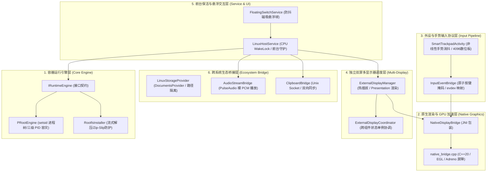

# ColorOS Linux 虚拟桌面 —— 开发者与 DIY 二次开发指南
> **"Every tablet deserves a full desktop workstation."**
> 本项目遵循完全开放、高内聚低耦合的模块化设计哲学，所有开发者皆可在此基础上自由定制发行版、渲染引擎、触控手势与双屏生态。

---

## 目录
- [一、 写给后续开源开发者的一封信](#一-写给后续开源开发者的一封信)
- [二、 架构解构与模块扩展拓扑](#二-架构解构与模块扩展拓扑)
- [三、 软件当前的开放程度剖析](#三-软件当前的开放程度剖析)
- [四、 本地编译、构建与静态验证指南](#四-本地编译构建与静态验证指南)
- [五、 核心 DIY 实战教程 (Step-by-Step Recipes)](#五-核心-diy-实战教程-step-by-step-recipes)
  - [Recipe 1：更换为 Arch Linux / Debian / Kali / Alpine 根文件系统](#recipe-1更换为-arch-linux--debian--kali--alpine-根文件系统)
  - [Recipe 2：更换桌面环境（LXQt / i3wm / DWM / 远程 Code-Server）](#recipe-2更换桌面环境lxqt--i3wm--dwm--远程-code-server)
  - [Recipe 3：适配非高通平台（联发科天玑 Mali GPU / Panfrost / VirGL）](#recipe-3适配非高通平台联发科天玑-mali-gpu--panfrost--virgl)
  - [Recipe 4：适配其他品牌触控笔（华为 M-Pencil / 小米灵感笔 / 三星 S-Pen）](#recipe-4适配其他品牌触控笔华为-m-pencil--小米灵感笔--三星-s-pen)
  - [Recipe 5：在智能触控板工具栏增加自定义宏与 Linux 快捷键](#recipe-5在智能触控板工具栏增加自定义宏与-linux-快捷键)
  - [Recipe 6：扩展双屏工作站（无线投屏 / USB 采集卡 / 异构多屏）](#recipe-6扩展双屏工作站无线投屏--usb-采集卡--异构多屏)
- [六、 后续开发者可能面临的深水区挑战与攻坚方向](#六-后续开发者可能面临的深水区挑战与攻坚方向)

---

## 一、 写给后续开源开发者的一封信

亲爱的开发者朋友：

你好！当你看到这份指南时，这个项目的第一阶段工程骨架已经构建完成并经过了严苛的工业级审查。我们完成了：
1. **Android 15+ / ColorOS 17** 前台保活特权与 setsid 孤儿进程清理机制；
2. **C++20 NDK EGL / GLES2** 硬件加速管线与高通 Adreno GPU 零拷贝热解绑安全屏障；
3. **Type-C / HDMI 独立双屏扩展桌面**，让外接大屏独占输出 Linux 4K 桌面，平板化身带非线性指针加速的高精度智能触控板与 4096 级压感数位板；
4. **ColorOS 文件管理器原生挂载 (SAF DocumentsProvider)** 与 **Unix Domain Socket 全双工实时剪贴板同步**；
5. **PulseAudio Simple Protocol PCM 直通**，打造低延迟免缓冲音频体验。

但这仅仅是**地基**。移动操作系统正以前所未有的速度迈向桌面级计算，而平板硬件的强悍算力（Snapdragon 8 Gen 2/3、天玑 9300+）绝不应该被局限在简单的内容消费与画画娱乐上。

这个项目的终极目标是：**打造一个让每个人都能自由定制、免 Root 运行、随时随地化身生产力工作站的极客工具。** 无论你是想打包属于你自己的 Kali 移动渗透测试工作站、打磨极简的 Arch Linux 编程终端，还是想为不同厂商的平板做外设适配，这里的代码都对你完全开放。

愿你能在这个坚实的基石上，创造出更惊艳的功能！

---

## 二、 架构解构与模块扩展拓扑

整个系统的核心职责划分为六个独立的子系统，它们之间通过强类型接口隔离：



---

## 三、 软件当前的开放程度剖析

| 层次 | 当前开放程度 | 自定义可行性 | 推荐 DIY 方向 |
| :--- | :---: | :---: | :--- |
| **Linux 发行版与软件包** | **100% 完全开放** | 极高 | 替换 Ubuntu 为 Arch Linux、Alpine、Debian、Kali Linux 等 |
| **桌面环境与窗口管理器** | **100% 完全开放** | 极高 | 替换 XFCE4 为 i3wm、Sway、KDE、Openbox，或启动无头 VS Code Server |
| **外接显示器双屏拓扑** | **100% 完全开放** | 高 | 接入无线投屏（Miracast）、USB 采集卡、或平板与外屏分屏独立操作 |
| **触控手势与工具栏** | **100% 完全开放** | 极高 | 增加自定义终端快捷宏（如 `git push`、`vim :wq`）、修改触控板非线性加速度曲线 |
| **手写笔压感与外设映射** | **100% 完全开放** | 高 | 适配华为 M-Pencil、小米手写笔、蓝牙数位板、自定义压感响应曲线 |
| **GPU 驱动与图形管线** | **90% 开放** | 中高 | 适配天玑芯片（Panfrost / VirGL / llvmpipe 软解） |
| **跨系统存储与剪贴板** | **100% 完全开放** | 极高 | 扩展剪贴板支持富文本、图片，或在原生文件管理中增加更多挂载分区 |

---

## 四、 本地编译、构建与静态验证指南

### 1. 编译环境要求
- **操作系统**：macOS 12+ / Ubuntu 22.04+ / Windows 11 (WSL2)
- **JDK**：OpenJDK 17 或 21
- **Android SDK**：API Level 35 (Android 15)
- **Android NDK**：Version 25.2.9519653 或更新
- **CMake**：3.22.1+

### 2. 核心校验脚本执行
在进行任何改动后，执行项目内置的完整性验证脚本：
```bash
./scripts/verify_project.sh
```
若出现 `[✓]` 全部通过，则证明 AndroidManifest、Gradle 依赖、C++ JNI 签名、XML 布局与所有 JUnit 单测均正常。

### 3. Gradle 构建命令
```bash
# 运行单元测试
./gradlew testDebugUnitTest

# 编译 Debug APK
./gradlew assembleDebug

# 生成 Release AAB
./gradlew bundleRelease
```

---

## 五、 核心 DIY 实战教程 (Step-by-Step Recipes)

### Recipe 1：更换为 Arch Linux / Debian / Kali / Alpine 根文件系统

1. **下载或制作目标架构根文件系统**（必须为 `aarch64` / `arm64`）：
   ```bash
   # 以 Arch Linux ARM 为例：
   wget http://os.archlinuxarm.org/os/ArchLinuxARM-aarch64-latest.tar.gz
   ```
2. **打包为 `.tar.gz` 规范压缩包**：
   将其命名为 `ubuntu-noble-xfce4-arm64.tar.gz`（或在 `RootfsInstaller.kt` 中修改 `ASSET_ARCHIVE_NAME`）。
3. **放置于资源目录**：
   ```bash
   mkdir -p app/src/main/assets/rootfs/
   cp ArchLinuxARM-aarch64-latest.tar.gz app/src/main/assets/rootfs/ubuntu-noble-xfce4-arm64.tar.gz
   ```
4. **调整初始化环境**：
   在 `PRootEngine.kt` 的 `launchScript` 中，将用户目录调整为你的默认用户（例如 `/home/arch` 或 `/root`）。

---

### Recipe 2：更换桌面环境（LXQt / i3wm / DWM / 远程 Code-Server）

1. **在 Rootfs 制作脚本 (`scripts/build_rootfs.sh`) 中安装目标桌面**：
   ```bash
   # 安装极简平铺式窗口管理器 i3：
   apt-get install -y i3 i3status dmenu xterm
   ```
2. **修改 `PRootEngine.kt` 中的启动命令**：
   找到 `launchScript` 中的最后一行：
   ```bash
   # 原 XFCE4 启动行：
   # exec dbus-launch --exit-with-session startxfce4

   # 替换为 i3wm：
   exec dbus-launch --exit-with-session i3

   # 或者替换为纯后台 VS Code Server（浏览器访问 127.0.0.1:8080）：
   # code-server --bind-addr 127.0.0.1:8080 --auth none &
   # exec openbox
   ```

---

### Recipe 3：适配非高通平台（联发科天玑 Mali GPU / Panfrost / VirGL）

当前项目默认启用了高通 Adreno 的 Turnip Vulkan 驱动。若运行在搭载**联发科天玑处理器（如天玑 9000/9200/9300）**的平板上，需要将驱动切为 VirGL 或软渲染：

打开 `app/src/main/java/com/oppo/coloros/linux/core/PRootEngine.kt`，定位到 `launchScript`：
```bash
# 【高通骁龙芯片配置】
export MESA_LOADER_DRIVER_OVERRIDE=zink
export TU_DEBUG=noconform
export GALLIUM_DRIVER=zink

# 【联发科天玑芯片 DIY 切换方案】：
# 方案 A (纯 CPU 软解，稳定性 100%)：
export LIBGL_ALWAYS_SOFTWARE=1
export GALLIUM_DRIVER=llvmpipe

# 方案 B (VirGL 硬件加速)：
export GALLIUM_DRIVER=virpipe
export VTEST_WIN=1
```

---

### Recipe 4：适配其他品牌触控笔（华为 M-Pencil / 小米灵感笔 / 三星 S-Pen）

本项目不仅支持 OPPO Pencil，通过扩展 `app/src/main/java/com/oppo/coloros/linux/bridge/InputEventBridge.kt`，可无缝支持市面主流平板触控笔：

```kotlin
// 识别三星 S-Pen / 华为 M-Pencil 等通用触控笔：
val toolType = event.getToolType(index)
val isStylus = toolType == MotionEvent.TOOL_TYPE_STYLUS || 
               toolType == MotionEvent.TOOL_TYPE_ERASER

if (isStylus) {
    // 提取压感 (部分厂商手写笔压力范围可能不同，做归一化截断)
    val rawPressure = event.getPressure(index)
    val normalizedPressure = rawPressure.coerceIn(0.0f, 1.0f)
    
    // 提取倾角 (Tilt) 与 方位角 (Orientation)
    val tilt = event.getAxisValue(MotionEvent.AXIS_TILT, index)
    val orientation = event.getAxisValue(MotionEvent.AXIS_ORIENTATION, index)

    NativeDisplayBridge.sendStylusEvent(
        x = mappedX,
        y = mappedY,
        action = action,
        pressure = normalizedPressure,
        tilt = tilt,
        isEraser = (toolType == MotionEvent.TOOL_TYPE_ERASER)
    )
}
```

---

### Recipe 5：在智能触控板工具栏增加自定义宏与 Linux 快捷键

若想在内屏触控板顶部工具栏（`SmartTrackpadActivity`）增加一键提交 Git 或 Vim 常用指令：

1. **在 `activity_smart_trackpad.xml` 增加按钮**：
   ```xml
   <Button
       android:id="@+id/btn_key_git_commit"
       style="?android:attr/buttonBarButtonStyle"
       android:layout_width="wrap_content"
       android:layout_height="36dp"
       android:text="Git Sync"
       android:textColor="#38BDF8" />
   ```
2. **在 `SmartTrackpadActivity.kt` 中添加点击监听**：
   ```kotlin
   findViewById<View>(R.id.btn_key_git_commit)?.setOnClickListener { v ->
       v.performHapticFeedback(HapticFeedbackConstants.KEYBOARD_TAP)
       // 原子注入组合键：Ctrl + C 清行，输入预设指令并回车
       InputEventBridge.sendKeyCombo(InputEventBridge.KEY_LEFTCTRL, InputEventBridge.KEY_C)
       // 发送文本或自定义键位
   }
   ```

---

### Recipe 6：扩展双屏工作站（无线投屏 / USB 采集卡 / 异构多屏）

`ExternalDisplayManager.kt` 依托标准 Android `DisplayManager.DISPLAY_CATEGORY_PRESENTATION`。
当插入以下设备时，均可自动触发独占桌面输出：
* **USB-C 转 HDMI / DP 直连线**；
* **Miracast / 无线投屏接收器**（在 Android 系统设置中开启无线显示）；
* **便携式带触控的副屏**（支持在 `LinuxPresentation.kt` 中直接触控外屏）。

---

## 六、 后续开发者可能面临的深水区挑战与攻坚方向

为了让后续接棒的开发者少走弯路，以下罗列了当前移动 Linux 虚拟机技术体系中已知的**天花板级挑战**与推荐的破解方向：

### 1. OEM 厂商激进后台进程冻结（ColorOS Hans / HyperOS 电池杀手）
* **现状**：即使申请了 `FOREGROUND_SERVICE` 与 `WAKE_LOCK`，ColorOS 在平板熄屏较长时间后，其内核级 Hans 模块仍可能把 `proot` 进程挂入 `cgroup frozen` 状态，导致长时间下载或后台编译任务降频甚至暂停。
* **攻坚建议**：
  1. 在 `MainActivity` 中引导用户勾选【允许后台高耗电】与【允许自启动】；
  2. 考虑在 `LinuxHostService` 中播放一段极低采样率的静音音频（AudioTrack Keep-Alive），这在 Android 音频子系统层级拥有最高防冻结优先级。

### 2. 根文件系统体积与 APK 尺寸的矛盾
* **现状**：一个完整的 Ubuntu + XFCE4 aarch64 镜像解压后约 1.2GB~1.8GB，压缩后仍有 300MB+。若直接打包进 APK assets，会导致 APK 过大且部分应用市场拒绝上架。
* **攻坚建议**：
  1. 将主工程 APK 体积精简至 20MB 以内，仅内置精简骨架系统；
  2. 在 `RootfsInstaller.kt` 中增加 HTTP 断点续传下载器，在首次启动时引导用户按需选择下载 Ubuntu、Debian 还是 Arch 镜像（类似 Termux PRoot-Distro）。

### 3. KVM 硬件虚拟化在未 Root 设备的受限
* **现状**：本项目采用的 PRoot（用户态系统调用拦截）在运行一般 GUI 软件与开发工具时极其流畅，但因无需 Root 且无法访问内核 `/dev/kvm`，因此无法在容器内运行原生 Docker 守护进程或嵌套启动 QEMU-KVM。
* **攻坚建议**：
  1. 探索基于 Root 权限的双模切换引擎（若检测到设备已解锁且内核包含 KVM，一键切换为底层 QEMU-KVM / crosvm 虚拟化模式）；
  2. 对于 Docker 需求，可在容器内引入 `podman`（rootless 模式）或利用远程 Docker Daemon 对接。

### 4. GPU 驱动跨代与跨厂商碎片化
* **现状**：高通新一代 Adreno 7xx / 8xx 的 Turnip 驱动需要较新的 Vulkan 扩展与更新版本的 Mesa 构建。
* **攻坚建议**：
  1. 将 Mesa 与 Turnip 构建为模块化热插拔驱动包（`.so` 文件），允许用户在应用设置里根据芯片型号手动选择 Mesa 23.x / 24.x 驱动版本。

---

> **祝代码永无 Bug，灵感无限！**
> 欢迎提交 PR 与 Issue，共同构建终极移动 Linux 工作站。
