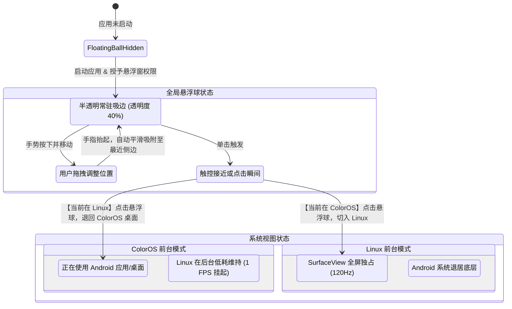
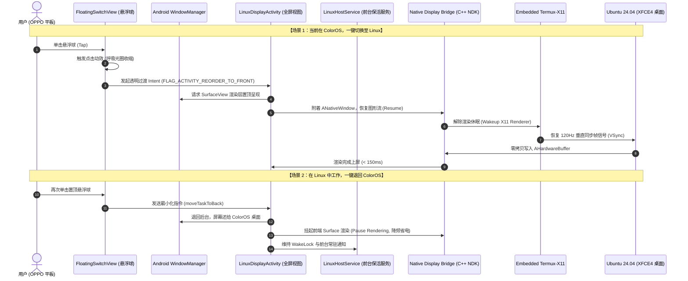

# OPPO ColorOS 17 Linux 虚拟桌面与一键切换系统

本项目致力于在 OPPO 平板（ColorOS 17，基于 Android 15/16）上构建一款具备桌面级体验的 Linux 运行环境，并实现**全局悬浮球“一键切换系统”**（在 Android 与 Ubuntu 桌面之间无缝极速切换）。

---

## 核心特性与技术规格

- **底层引擎**：高性能免 Root 用户态容器（PRoot + Box64）。
- **图形渲染管线**：嵌入式 Termux-X11 + AHardwareBuffer + Zink/Turnip (Adreno GPU 满血 Vulkan 硬件加速，支持 120Hz 刷新率)。
- **一键切换交互**：全局半透明磁吸悬浮球（基于 `SYSTEM_ALERT_WINDOW`），支持随处触控吸附、一键切换、3D 展开/收起过渡动效。
- **预置桌面环境**：Ubuntu 24.04 LTS (Noble aarch64) + 触控优化版 XFCE4 桌面环境（内存常驻 < 350MB，冷启动仅需 2~3 秒）。
- **ColorOS 17 专项保活**：持有 WakeLock 与前台特权服务（`specialUse`），避免后台运行被 ColorOS 智能冻结或 LMK 查杀。

---

## 核心架构流程

### 1. 全局悬浮球交互与双系统状态转移图


### 2. 点击悬浮球一键切换时序图


---

## 目录结构规划

```
├── app/
│   ├── src/main/
│   │   ├── java/com/oppo/linuxvm/
│   │   │   ├── ui/overlay/FloatingSwitchService.kt   # 全局置顶悬浮球服务
│   │   │   ├── ui/LinuxDisplayActivity.kt           # 全屏 Linux 视口 SurfaceView
│   │   │   ├── service/LinuxHostService.kt          # 前台保活与 Wakelock 守护
│   │   │   ├── bridge/NativeBridge.kt               # JNI 接口包装
│   │   │   └── engine/PRootEngine.kt                # PRoot 容器引擎
│   │   ├── cpp/                                     # NDK 图形与零拷贝渲染桥接
│   │   └── assets/                                  # 预置二进制与精简 Ubuntu rootfs
├── docs/                                            # 架构文档与流程设计
└── scripts/                                         # 自动化构建脚本
```
