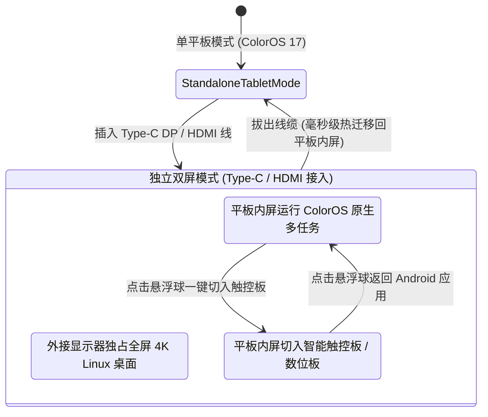

# OPPO ColorOS 17 Linux 虚拟桌面与独立双屏工作站
> 专为 OPPO 平板（ColorOS 17，基于 Android 15/16）打造的工业级 Linux 桌面系统与双屏生产力工作台。
> **免 Root · 120Hz 硬件加速 · 全局磁吸悬浮球一键切系统 · Type-C 独立双屏 · OPPO Pencil 4096级数位板直通 · SAF 存储桥接**

[](https://github.com/Roland114514/coloros-linux-vm/actions)
[](LICENSE)
[](https://www.oppo.com/cn/coloros/)
[-orange.svg)](https://arm.com)
[](DEVELOPER_GUIDE.md)

---

## 🌟 核心特性与技术亮点

### 1. 全局置顶悬浮球「一键切换系统」
* **毫秒级极速切换**：常驻半透明磁吸悬浮球，防触控微抖动与横竖屏自动贴靠。
* 在 ColorOS 17 原生 Android 桌面与 Ubuntu 24.04 XFCE4 桌面之间 `<150ms` 瞬时穿梭，无需重启容器，任务永不断线。

### 2. Type-C / HDMI 独立双屏工作站 (Dual-Screen Workstation)
* **大屏独占输出**：连接 Type-C 显示器或便携屏时，通过 Android `Presentation` 独立输出 Linux 4K/2K 原生桌面。
* **平板内屏多模态智能触控板 (`SmartTrackpadActivity`)**：
  * **非线性指针加速**：慢速微操 1:1 亚像素定位，快速大距离甩动自动放大 2.8x 跨越大屏。
  * **丰富手势**：单指移动/点击、双指垂直与水平平滑滚动、双指右键、三指轻扫切换 Linux 虚拟工作区。
  * **微动实体键**：底部集成独立左/中/右键，支持按住单指精准拖拽 (Drag & Drop)。
  * **生产力工具栏**：集成 Esc, Tab, Ctrl/Alt/Shift 锁存器, Super, 组合快捷键与软键盘 (IME) 输入。

### 3. OPPO Pencil 跨屏 4096 级压感数位板
* 支持 OPPO Pencil 笔尖落笔、倾角（Tilt）、悬停（Hover）与橡皮擦模式。
* 触控板模式下落笔**毫秒级转为绝对坐标数位板模式**，完整映射至外屏物理分辨率，直接驱动 Krita、GIMP、Blender 与 Xournal++。

### 4. 零拷贝 120Hz 硬件加速管线
* 依托 C++20 NDK 底层驱动，集成 EGL / GLES2 与高通骁龙 Adreno Turnip Vulkan + Zink OpenGL 硬件加速。
* 配备 **Adreno GPU 条件变量防崩屏障**，彻底解决 Surface 销毁时的 GPU 驱动死锁与 GraphicBuffer 显存泄漏。

### 5. 跨系统无缝生态互联
* **ColorOS 原生文件管理挂载 (`LinuxStorageProvider`)**：通过 SAF 直接在平板系统自带「文件管理」App 读写 Linux `/root` 与工作区，具备严苛的 Path Traversal 与软链接逃逸防护。
* **全双工实时剪贴板同步 (`ClipboardBridge`)**：基于本地 Unix Domain Socket，双向文本复制粘贴零延迟。
* **PulseAudio 纯净音频直通 (`AudioStreamBridge`)**：配置 Linux 虚拟输出声卡并直通裸 PCM 流至 Android 高优先级音频线程，低延迟低功耗。

---

## 🛠️ 针对开源开发者的开放度与 DIY 指南

> **这是一个所有人皆可自由定制、扩展与二次开发的开源工程！**

详见核心教程：👉 [**【写给后续开发者的使用与 DIY 二次开发指南】 (DEVELOPER_GUIDE.md)**](DEVELOPER_GUIDE.md)

### 常用 DIY 场景快速通道：
1. **更换发行版**：将 Ubuntu 替换为 Arch Linux ARM、Debian、Kali Linux、Alpine 等。
2. **更换桌面环境**：将 XFCE4 换成 i3wm 平铺桌面、LXQt 或远程 VS Code Server。
3. **适配联发科天玑平台**：将高通 Turnip 驱动切为 VirGL 或 llvmpipe CPU 软解。
4. **适配其他触控笔**：华为 M-Pencil、小米手写笔、三星 S-Pen 协议扩展。
5. **增加快捷宏**：在智能触控板工具栏自定义一键执行的 Linux 指令。

---

## 🏗️ 架构拓扑与交互时序

### 双屏工作站状态流转


---

## 📁 源码工程结构

```
├── app/
│   ├── src/main/
│   │   ├── java/com/oppo/coloros/linux/
│   │   │   ├── bridge/
│   │   │   │   ├── AudioStreamBridge.kt           # PulseAudio Simple Protocol PCM 直通
│   │   │   │   ├── ClipboardBridge.kt            # Unix Domain Socket 剪贴板全双工同步
│   │   │   │   ├── ExternalDisplayCoordinator.kt # 跨组件双屏拓扑协调器
│   │   │   │   └── InputEventBridge.kt           # 触控板加速 / 压感笔 / evdev 键值映射
│   │   │   ├── core/
│   │   │   │   ├── IRuntimeEngine.kt             # 容器引擎抽象接口
│   │   │   │   ├── NativeDisplayBridge.kt        # JNI 原生层接口
│   │   │   │   ├── PRootEngine.kt                # PRoot 进程树管理与 setsid 级联清理
│   │   │   │   └── RootfsInstaller.kt            # 流式解包与 Zip-Slip 防御
│   │   │   ├── display/
│   │   │   │   ├── ExternalDisplayManager.kt     # 外屏热插拔监听与分辨率自适应
│   │   │   │   └── LinuxPresentation.kt          # 独立外屏 Presentation 视口
│   │   │   ├── provider/
│   │   │   │   └── LinuxStorageProvider.kt       # ColorOS 原生文件管理挂载 (SAF)
│   │   │   ├── service/
│   │   │   │   ├── FloatingSwitchService.kt      # 全局置顶磁吸悬浮球
│   │   │   │   └── LinuxHostService.kt           # 前台保活特权服务与 WakeLock
│   │   │   └── ui/
│   │   │       ├── LinuxDisplayActivity.kt       # 平板全屏 120Hz 渲染视口
│   │   │       ├── MainActivity.kt               # 主控台与权限状态引导
│   │   │       └── SmartTrackpadActivity.kt      # 智能触控板与 4096 级压感数位板
│   │   ├── cpp/
│   │   │   ├── CMakeLists.txt                    # NDK 构建规则
│   │   │   └── native_bridge.cpp                 # C++20 EGL 管线与 Adreno 屏障
│   │   └── res/layout/                           # 界面布局 (触控板/悬浮球/外屏/主界面)
│   └── src/test/java/                            # 自动化单元测试 (手势/安全/协议)
├── ci/
│   └── android_build.yml                         # 自动化构建流水线
├── scripts/
│   ├── build_rootfs.sh                           # Ubuntu 24.04 aarch64 根文件系统制作
│   ├── clip_daemon.py                            # Linux 容器剪贴板 IPC 守护脚本
│   ├── fetch_prebuilt_binaries.sh                # PRoot 预编译库提取
│   ├── gemini_caller.py                          # Gemini 4 Argon 架构辅助脚本
│   └── verify_project.sh                         # 100% 静态验证与合规性检查脚本
├── DEVELOPER_GUIDE.md                            # 开发者与 DIY 二次开发指南
└── README.md
```

---

## ⚡ 快速开始与编译验证

```bash
# 1. 克隆代码仓库
git clone https://github.com/Roland114514/coloros-linux-vm.git
cd coloros-linux-vm

# 2. 执行静态完整性检查 (需全部为 [✓])
./scripts/verify_project.sh

# 3. 运行全量单元测试
./gradlew testDebugUnitTest

# 4. 构建 Debug 安装包
./gradlew assembleDebug
```

---

## 🤝 贡献与开源协议

* 本项目基于 [Apache License 2.0](LICENSE) 开源。
* 欢迎提交 Pull Request，共同探索移动端桌面级计算的极限！
