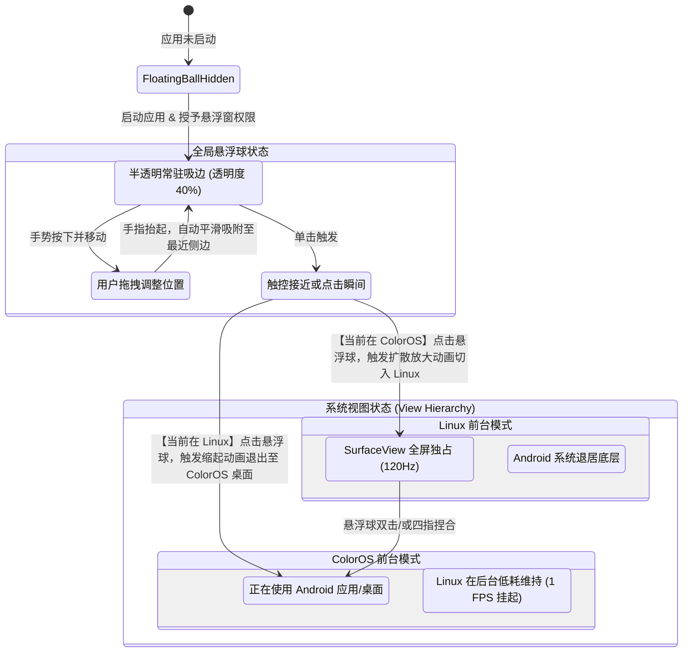
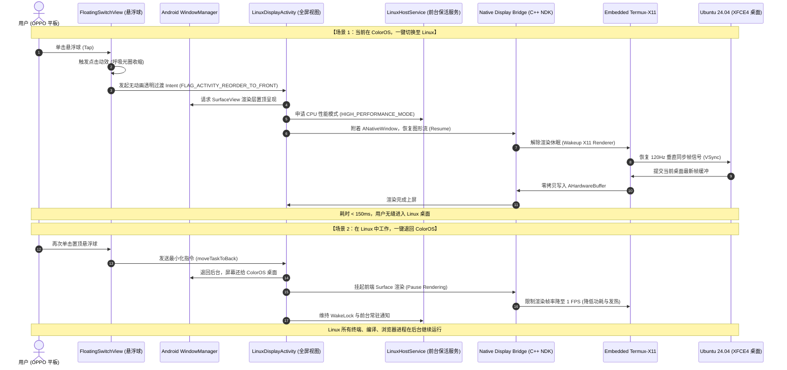
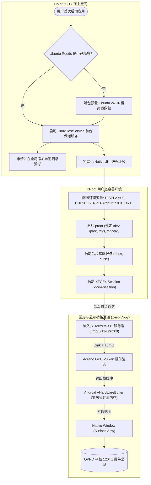

# OPPO 平板（ColorOS 17）Linux 虚拟桌面系统架构方案与高精度流程图

## 1. 最终技术规格定型 (Specification)

| 维度 | 规格选择 | 决策依据与技术指标 |
| :--- | :--- | :--- |
| **底层核心** | **方案 A：高性能免 Root 容器 (PRoot)** | 普通 APK 直接安装即可使用，CPU 损耗接近 0%，无视 ColorOS 对 `/dev/kvm` 的封锁。 |
| **图形渲染** | **嵌入式 Termux-X11 + AHardwareBuffer + Zink/Turnip** | 零拷贝共享内存直接送显 Android `SurfaceView`，Adreno GPU 满血 Vulkan 硬件加速，支持 120Hz 高刷。 |
| **交互形态** | **全局置顶悬浮球 (Floating Switch Pill)** | 基于 `SYSTEM_ALERT_WINDOW` 实现随处可点击、磁吸边缘的半透明悬浮球，点击触发系统级极速过渡动画。 |
| **桌面环境** | **Ubuntu 24.04 LTS (Noble) + 触控优化版 XFCE4** | 内存开销极低（常驻空载 < 350MB），冷启动仅需 2~3 秒，对平板触摸与 OPPO Pencil 压感支持极度稳定。 |
| **宿主系统** | **OPPO ColorOS 17 (基于 Android 15/16)** | 配套专属的前台特权服务与防后台智能冻结策略。 |

---

## 2. 核心架构与流程图

### 2.1 全局置顶悬浮球交互与显示层状态转移图

### 2.2 “点击悬浮球一键切换” 端到端时序图

### 2.3 容器底层启动与图形管线流程

